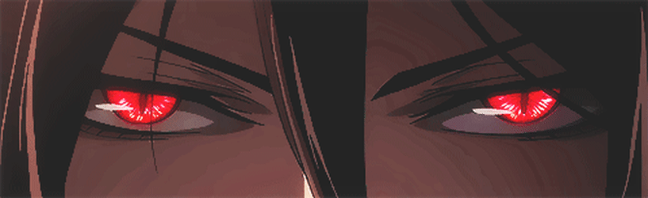
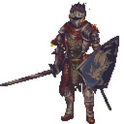
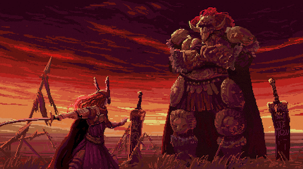

  

# About Me:

I'm **Vampire** 🧛‍♂️, a tech enthusiast who codes by night (and day 😄)  
🔬 Completed an **IEEE project**, and I love reading **IEEE research papers** & **Quantum magazines** 
📊 Currently sharpening my skills in **DSA with C++** 
💻 Comfortable with a few **programming languages** 
✨ Proud **vibe coder**, building things that just *feel* right 
 

     

# 💻 Tech Stack:
                     

# GitHub Stats

<picture>
  <source media="(prefers-color-scheme: dark)" srcset="assets/snake-dark.svg">
  
</picture>

 

 
<table width="100%">
  <tr>
    <td width="50%" align="center">
      
    </td>
    <td width="50%" align="center">
      
    </td>
  </tr>
</table>

### Random Dev Quote

  

